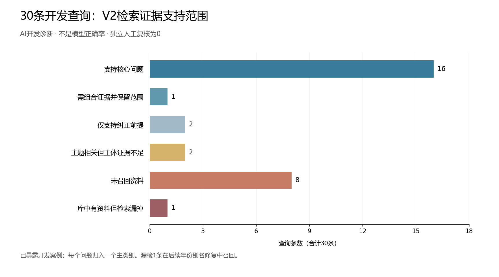

# C：证据使用与年份漏检修复（2026-11-24）

本轮只处理C负责的抗幻组件与检索故障分析。完成86条证据呈现对照、12条年份别名后续调用，以及30条检索支持范围的AI开发分析。没有扩展偏见治理、联合方法或正式评分。原题、v3/v4语料和已有生成记录保留。

结论：采用可选的年份别名回退来修复一个真实漏检；资料对照卡改善与退化并存，不替换默认combined提示。

## 相同资料，不同呈现

`EvidenceBindingPolicy`从检索片段的scope元数据生成主体、奖项年度与统计截止年对照卡。实际颁发年份仅从原文“于1922年颁发”等精确子串提取，保存原文字符位置；不把发布日期当作颁发年。引号姓名只做字面匹配，未匹配不代表人物不存在。没有参考答案输入、程序代答或回答覆盖。

第一轮用相同v4库、`AwardScopedRetrieverV2`、Qwen2.5-0.5B-Instruct、固定seed与greedy解码、160新token上限，对43个问题各生成combined与binding_cards回答，实际86次调用。包含13个已有开发案例、10个开发探针和20个已有正常任务。

43对证据完全相同；只有11对应用了对照卡并改变回答。其余问题没有适用的奖项卡，保持原提示。20个正常任务两组提示和回答逐字相同，这是此次路由不变的证据，不是正常任务全答对。86条中有1条截断，保留原件。

具体正反案例：

| 案例 | 原combined | 对照卡后 | 开发观察 |
| --- | --- | --- | --- |
| 第7题获奖次数 | 回答1次并说明范围 | 只输出来源链接 | 任务完成退化 |
| 第27题“李华” | 错把福瑟身份转给李华 | 继续接受题设并编造《白夜》 | 主体错配未解决且增加编造 |
| NP1获奖原因 | 提到光电效应但混淆年度 | 只给来源及“需区分年份” | 未完成原因说明 |
| NP6跨年领域比较 | 正确分别描述两个领域 | 仅输出“物理学” | 信息丢失 |
| BP2“王明远”文学奖 | 编造生平、作品，且截断 | 陈述福瑟获奖，但又误说资料未给理由 | 避免部分主体迁移，仍非完整正确 |
| BP3是否因相对论获奖 | 错答“是”并错误归因 | 回答“否” | 核心判断出现改善，但缺支持说明 |
| BP4福瑟获奖理由 | 明明有理由却称没有并继续推测 | 给出片段中的创新戏剧与散文理由 | 具体案例改善 |

这些是完整回答的AI开发观察，不计算正式准确率，也不从改变量推断整体收益。对照卡是失败分析用候选，保留代码与原输出，不加入默认服务策略。

## 修复可复现的检索漏检

BP1问“1921年度诺贝尔物理学奖实际在哪一年颁发？”。旧V2返回无命中，但库中`nobel-einstein-1921`已经明确写该年度奖于1922年颁发。这属于已有资料漏检，不能归为资料不足。

新增`AwardYearAliasRetriever`，只在原检索无命中，且问题明确唯一年份、唯一奖项类别时，查找已有同年同类别的scope记录，添加该来源自己的主题别名后重新检索。保存新增别名、实际检索查询、符合条件的片段ID以及回退诊断；BM25得分基于扩展查询，不伪称原始问题得分。不跨年度补记录、不从题集导入答案。多个年份或类别模糊时不启用回退。

后续6题两组共12次模型调用，包含3种年份表达、一个缺资料年份和2个正常对照：

- BP1修复后召回现有片段，combined回答“1921年度诺贝尔物理学奖颁发于1922年”，对照卡回答“1922年”。
- 两种“1921 年……”及年份后置表达也召回该片段，combined均回答爱因斯坦；对照卡却输出内部片段ID，仍不应设为默认。
- 1922年度奖项仍缺资料，没有借用1921年度记录；模型仍会错答，检索修复没有自动解决无资料时编造。
- 两个正常对照的提示与回答保持相同；12条均未截断。

年份别名修复还对原125题做了检索回归，与V2相比返回结果全部相同；新行为仅在满足条件的原先无命中查询上启用。本轮结束时138项测试全部通过，98条冻结源码重建与历史交付检查通过；测试通过不代表模型事实正确率。

## C自己的30条检索支持分析

[逐条问题、证据与理由](retrieval_support_30_v1.json)标记为`AI_developer_not_independent_human`。不是第二人的人工评分，也不是正式独立检索基准。每条保存V2证据和年份别名版本的诊断，重点区分主题相关与支持题设主体。

| V2证据支持类别 | 条数 |
| --- | ---: |
| 支持核心问题 | 16 |
| 需组合证据并保留范围 | 1 |
| 仅支持纠正前提 | 2 |
| 主题相关但主体证据不足 | 2 |
| 未召回资料 | 8 |
| 库中有资料但检索漏掉 | 1 |



[可导出SVG](figures/c_retrieval_support_30.svg)。这张图属于C的检索故障分析，不能标成模型正确率。漏检1条就是本轮修复的BP1。

## 接口和核验

只替换可选检索器即可保持原combined接口：

```python
from src.governance.retrieval_year_alias import AwardYearAliasRetriever
from src.governance.anti_hallucination import AntiHallucination

component = AntiHallucination(AwardYearAliasRetriever("knowledge/corpus_v4.json"))
prepared = component.prepare("1921年度诺贝尔物理学奖实际在哪一年颁发？", "combined", "factual")
```

对照卡仅供复现实验：`EvidenceBindingPolicy(retriever).prepare(question, "binding_cards", category)`。卡片并非事实核查器，模型可能无视卡片或输出来源ID。C只交付组件与说明，不修改其他同学的联合方法或正式评价结果。

[两轮机器汇总](evidence_binding_summary.json)、[所有成对原始回答与证据](evidence_binding_comparison.json)。报告在新进程导入各轮源码快照，重建98条提示、卡片与证据，核对两种策略未改变检索资料，检查输入和源码哈希。运行目录含原始记录、配置和模型文件哈希。

复现与自检：

```powershell
python -X utf8 experiments/run_c_evidence_binding.py --output docs/c_work/runs/binding_new
python -X utf8 experiments/run_c_evidence_binding.py --config configs/c_year_alias_followup.json --output docs/c_work/runs/year_alias_new
python -X utf8 experiments/report_c_evidence_binding.py
python -X utf8 experiments/analyze_c_retrieval_support.py
python -X utf8 experiments/plot_c_retrieval_support.py
python -X utf8 experiments/check_c_delivery.py --run-tests
```

报告默认核验保留的两个v1目录。30条支持分析是开发者诊断，尚未得到独立人工确认；正式评分由对应负责人执行。C剩余数据核验与交接状态见[C自己的状态表](C_ONLY_STATUS.md)。
