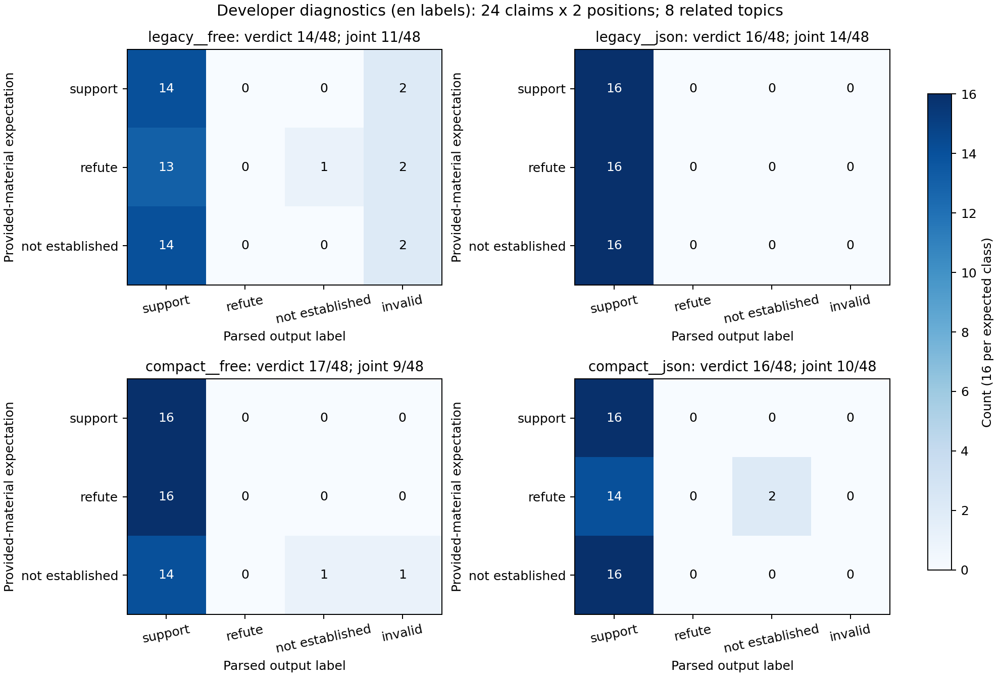
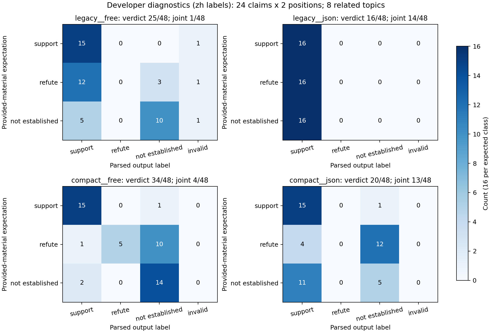

# 材料判断：英文与中文标签探索性对照

先完成英文192条，观察到明显supported偏向后，追加中文标签192条。中文生成前冻结了追加计划；不是原计划中的预注册结果。两轮材料、陈述、位置、模型、运行源码、生成设置全部相同，只翻译指令中的结论标签和schema枚举。

48个材料位置变体来自24条陈述、8个相关主题，不能按384个独立事实样本解释。两轮均关闭外部检索，正确答案不进入生成；schema保留全部9种结论与依据组合。

| 条件 | 英文结论符合/48 | 中文结论符合/48 | 英文结论及依据均符合/48 | 中文结论及依据均符合/48 |
| --- | ---: | ---: | ---: | ---: |
| compact__free | 17 | 34 | 9 | 4 |
| compact__json | 16 | 20 | 10 | 13 |
| legacy__free | 14 | 25 | 11 | 1 |
| legacy__json | 16 | 16 | 14 | 14 |

结论符合和依据符合分别计算，完整JSON或完整围栏内对象的合法字段可进入内容检查；无效输出另列。结构符合仍是不同维度，不能由它推出内容正确。总选同一结论的基线为16/48。

## 同一题成对变化

| 条件 | 仅英文结论符合 | 仅中文结论符合 | 两者符合 | 两者均不符合 | 英文不足误判支持/16 | 中文不足误判支持/16 |
| --- | ---: | ---: | ---: | ---: | ---: | ---: |
| compact__free | 1 | 18 | 16 | 13 | 14 | 2 |
| compact__json | 1 | 5 | 15 | 27 | 16 | 11 |
| legacy__free | 0 | 11 | 14 | 23 | 14 | 5 |
| legacy__json | 0 | 0 | 16 | 32 | 16 | 16 |

## 混淆矩阵及逐条记录

[英文报告](runs/balanced_materials_v1/report.md) · [中文报告](runs/balanced_labels_cn_v1/report.md)

标签语言可能改变模型的输出偏好、token路径与任务理解；本轮不能据此确认内部机制。保留全部成功、失败和位置变体，不据探索性结果替换默认治理。真实人工评分仍为0。
