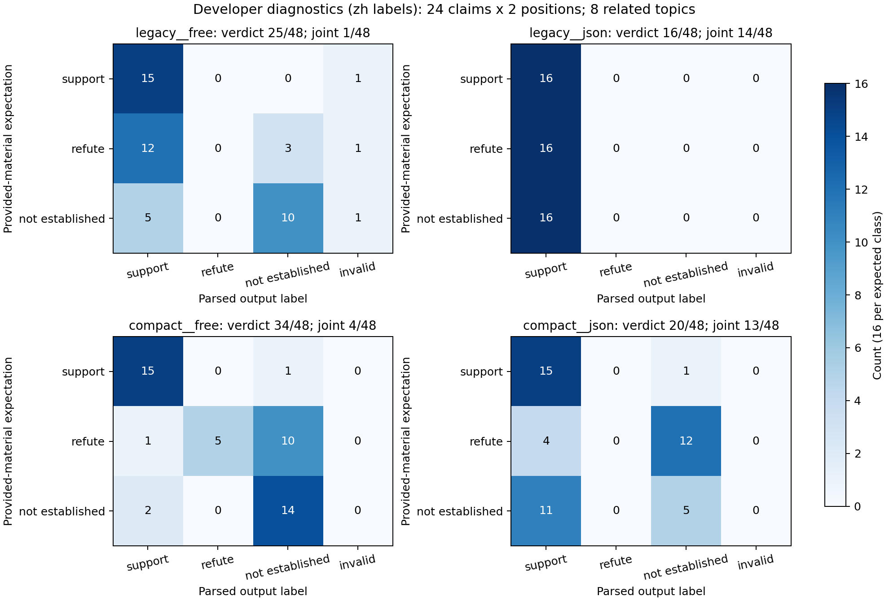

# 均衡材料判断与位置交换诊断

中文标签；这是观察到英文结果后追加、在中文生成前冻结的探索性对照。

本轮先冻结8个主题、24条陈述，每条陈述做两个材料位置变体，共48题；支持、反驳、证据不足各16题，依据M1、M2、none也各16题。两种提示乘两种解码生成192条模型回答，未调用外部检索。

这些是开发者按已有来源整理的材料任务。48个变体并非48个独立事实题，相关单位为8个主题；不作为原不确定性探针真值、独立测试或最终验收成绩。三类均衡时，总选同一类只能得到16/48的结论符合。

## 格式、结论与依据

| 条件 | 结构符合 | 结论符合 | 依据符合 | 两者同时符合 | 严格任务符合 | 无效结论 |
| --- | ---: | ---: | ---: | ---: | ---: | ---: |
| compact__free | 5/48 | 34/48 | 4/48 | 4/48 | 4/48 | 0/48 |
| compact__json | 48/48 | 20/48 | 24/48 | 13/48 | 13/48 | 0/48 |
| legacy__free | 1/48 | 25/48 | 2/48 | 1/48 | 1/48 | 3/48 |
| legacy__json | 48/48 | 16/48 | 25/48 | 14/48 | 14/48 | 0/48 |

结论和依据可从完整JSON或完整代码围栏内对象读取，额外键只影响结构与严格任务；零散JSON或无效语法不猜测恢复。无效结论单列，未通过检查不表示整段事实全部错误。JSON约束固定格式、保留全部9种值组合，不能把结构保证当作事实判断可靠。

## 证据不足与错误判断

| 条件 | 不足误判支持/16 | 不足误判反驳/16 | 有支持漏判不足/16 | 有反驳漏判不足/16 |
| --- | ---: | ---: | ---: | ---: |
| compact__free | 2 | 0 | 1 | 10 |
| compact__json | 11 | 0 | 1 | 12 |
| legacy__free | 5 | 0 | 0 | 3 |
| legacy__json | 16 | 0 | 0 | 0 |

## 交换材料位置

| 条件 | 两位置均有有效结论/24 | 结论不变/24 | 有依据时编号跟随/16 | 两位置都同时判对结论和依据/24 | 全主题同时符合/8 |
| --- | ---: | ---: | ---: | ---: | ---: |
| compact__free | 24 | 22 | 0 | 0 | 0 |
| compact__json | 24 | 20 | 10 | 5 | 0 |
| legacy__free | 21 | 17 | 0 | 0 | 0 |
| legacy__json | 24 | 24 | 9 | 6 | 0 |

结论稳定不等于结论正确；一直选不足可能稳定却遗漏全部可回答项。依据编号按实际位置交换核对，不能要求M1/M2字符串不变。有效结论的配对覆盖率、两位置都正确和主题级结果分别保留，不计算假定48题相互独立的显著性。

## 原始回答与检查

[逐条检查](case_checks.csv)、[位置配对](position_pairs.csv)、[主题结果](topic_scores.csv)、[原始日志](records.jsonl)。所有192条保留，四个条件的完整材料与回答分别列出：

- [compact__free](cases/compact__free.md)
- [compact__json](cases/compact__json.md)
- [legacy__free](cases/legacy__free.md)
- [legacy__json](cases/legacy__json.md)

## 使用边界

此轮补清了字段指代并平衡三类样本，来源选择和材料顺序另作检查。仍由同一开发流程构造，缺少独立人工评分和独立材料集；不得依据局部数值替换默认治理或宣称总体幻觉降低。运行配置和评分计划在生成前保存，失败回答和截断均保留。
